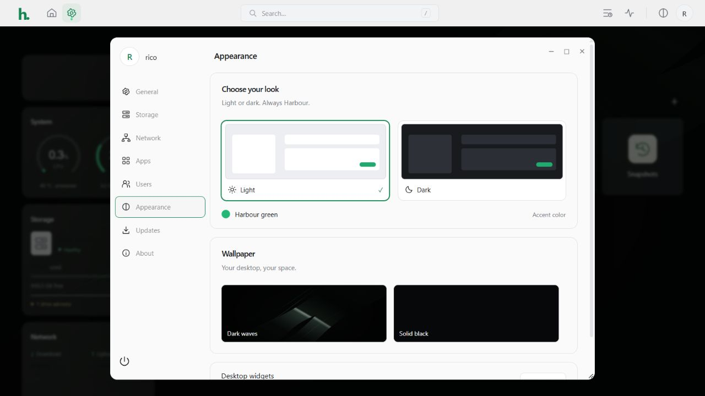
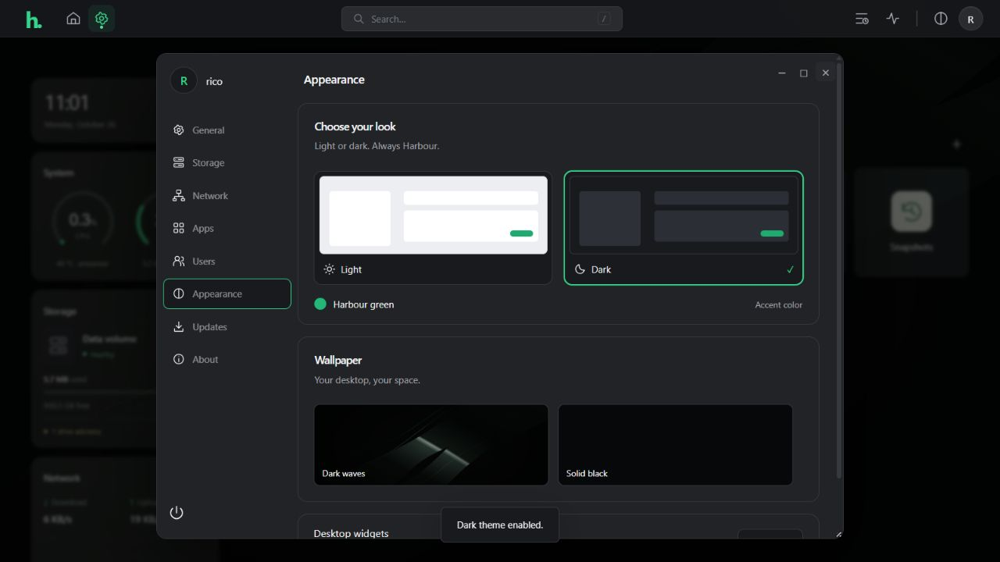
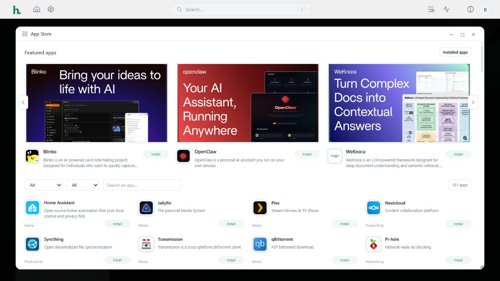

# Harbour OS 0.5.0 — light and dark desktop

## Switching themes

Open **Settings → Appearance** and select **Light** or **Dark**. Both use Harbour green for the primary controls, selection and focus states. General settings and the Files header also provide compact theme switches; the top bar provides a quick toggle on larger screens.

The choice is saved in this browser and applied before the styles load to avoid a theme flash. Time format and widget preferences are also saved locally. Folder favorites are scoped to the signed-in username in that browser and filtered to the shares the account can access. Signing into another browser does not copy these preferences automatically.

## Reference-based layouts

- **Desktop:** compact clock, CPU/RAM gauges, storage and network cards, inline widget switches, square launchers and a local glass-style wallpaper. Existing drag-to-reorder launchers remain available.
- **Files:** app branding and sidebar cards, favorites, storage and Trash locations, Back/Forward history, compact toolbar, list/grid choices, amber folder graphics, document icons, image thumbnails, selection actions and storage status. Existing copy/move/rename, recoverable deletion, restore and permissions remain in use.
- **App Store:** featured banners and summaries, category/status/search controls, compact app entries and install/open pills. The catalog remains the existing 181 real definitions. Banner navigation changes only the featured area, rather than reopening the entire window.
- **Settings:** profile/sidebar navigation, device-information card, grouped preference rows, wallpaper choices, theme previews, power controls and the existing Network/Updates pages.
- **Storage:** segmented usage display, green Create storage banner, disk status, and a RAID comparison with protection, minimum disks, relative speed, capacity and intended use. JBOD and additional RAID layouts remain available. Unsupported online expansion is shown as unavailable.
- **Motion:** restrained window/dialog entry, hover and carousel transitions, with a reduced-motion override. Folder navigation and background refreshes do not replay the window-opening animation. Settings titles and the Files brand remain window drag handles.

Themes change presentation. They do not change NAS authentication, account privileges, folder permissions, network configuration, or the update signing key. Storage creation still uses stable device identities, protected-disk checks, a reviewed plan, an erasure acknowledgement and typed confirmation. No drives were erased or reconfigured for this redesign.

## Reference review and artwork

The design review used all seven supplied screenshots and the complete visual timeline of [OMC's ZimaOS beginner guide](https://www.youtube.com/watch?v=81tN07ghNs0). Local research sampled 222 frames at five-second intervals across all 12 chapters, with focused review of desktop, Settings, storage, App Store and Files sequences. The research video and supplied screenshots are not included in the source or update bundle.

Featured artwork is bundled unchanged from the existing pinned [CasaOS-AppStore](https://github.com/IceWhaleTech/CasaOS-AppStore) revision, with source URLs and hashes in `harbor/catalog/featured-artwork.json`. Its Apache-2.0 license and attribution are retained. The Harbour wallpaper and device illustration are original SVG assets. No remote fonts or banner requests are needed at runtime.

This is an independent Harbour interface, not a claim of complete ZimaOS feature or pixel parity. The video's native cloud-backup service, ZVM, private ZimaClient/P2P features and reset workflow have not been added by this visual release. Existing Harbour integrations and constraints remain documented in the earlier release notes.

## Installation and validation

Version 0.5.0 is a signed in-place update. The published 0.3.1 graphical ISO remains the tested installation baseline; no new 0.5.0 ISO is claimed. The one-time updater bridge now recognizes the current source version while preserving the baseline label until a signed bundle is installed. See [updates and bonding](UPDATES-AND-BONDING-0.4.md) and [public GitHub updates](GITHUB-UPDATES-0.4.1.md).

Validation includes 48 automated tests, JavaScript syntax checks, browser checks for both themes and persistence, catalog filtering and banner navigation, file favorites/history/selection/copying using disposable demo files, inline widget switches, a real signed VM upgrade, and an installed-NAS check. The NAS upgrade preserves its account, storage and network and does not reboot it. Machine-readable results accompany this document.

