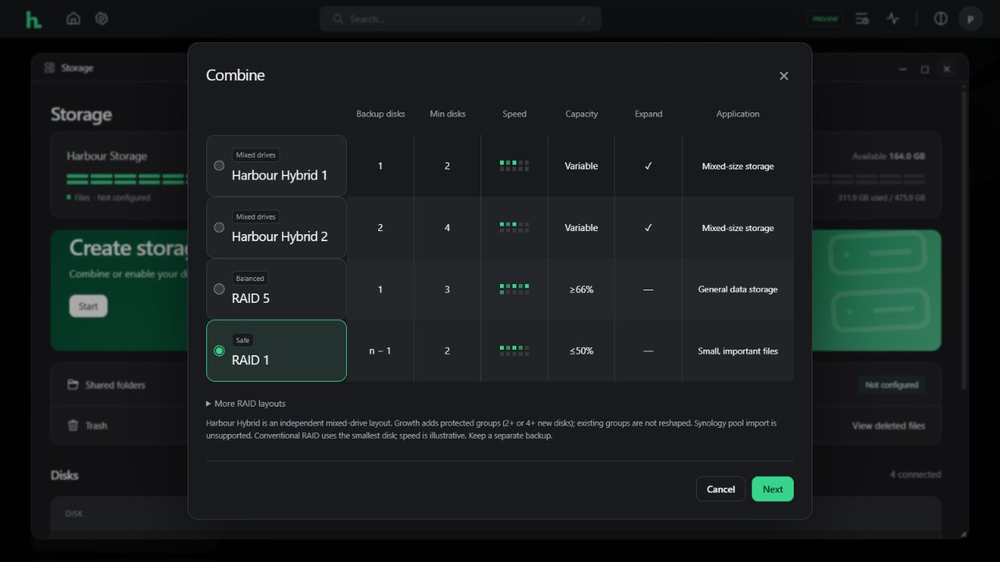

# Harbour Hybrid storage and expansion (0.6.0)

Harbour Hybrid 1 and 2 are independent mixed-drive storage layouts, intended for new installations and new pools. They are not Synology SHR on-disk formats and do not import Synology pools. Existing pools are never converted automatically.

## Protection and layout

Hybrid 1 requires at least two healthy disks and protects against one drive failure. A two-member tier uses Linux MD RAID1; tiers with three or more members use MD RAID5. Hybrid 2 requires at least four healthy disks and uses MD RAID6 tiers for two-drive protection. Each tier has members on distinct physical disks. A Btrfs filesystem spans those protected MD devices using single data and DUP metadata; drive redundancy is provided underneath by MD, not Btrfs RAID5/6.

Drive sizes are rounded down in 256 MiB bands with space reserved for GPT and MD metadata. Bands are allocated only if enough drives participate to provide the selected protection. Larger unmatched tails remain unallocated. Capacity shown before formatting is an estimate; filesystem metadata and allocation overhead reduce available file space. Data disks must be at least 512 MiB; this version supports at most 24 disks per pool.

The boot configuration records MD UUIDs and the Btrfs UUID. Initial MD synchronization may continue after creation; every tier's state is shown in Storage. Expansion waits until all tiers are healthy and synchronized.

## New pools

Choose Storage → Create storage → Combine → Harbour Hybrid 1 or Harbour Hybrid 2. Review disk identities, estimated capacity and unused space, then explicitly acknowledge erasure and type the pool confirmation phrase. Only selected available disks are formatted. Mounted devices, OS disks, active RAID members, changed disk identities and known failing SMART health are rejected. Missing tools and active partition holders are checked before disk writes.

Signatures on confirmed unused old partitions are cleared before recreating GPT, preventing old arrays from automatically reassembling while their partition offsets are reused. Existing mounted pools remain protected from creation.

## Expansion

**Hybrid pools grow by adding a NEW protected group:** at least two unused disks for Hybrid 1 or four for Hybrid 2. The new group may contain mixed sizes. Existing groups are retained; they are not reshaped. Unallocated tails in existing groups are not reclaimed by this release. Single-drive parity reshaping, Hybrid 1-to-2 conversion and automated drive replacement are not implemented.

**Native Btrfs RAID1 pools can grow by adding one or more unused disks.** The existing filesystem UUID and RAID1 data/metadata profiles are retained. The service verifies direct disk/partition members on distinct physical drives, checks device error counters and available balancing space, and performs an online balance. The pool is not reformatted or converted to Hybrid. This operation can run for a long time on a populated pool.

Expansion requires a mounted, healthy pool, no running balance, stable new disk identities and explicit acknowledgement that only the NEW disks will be erased. The confirmation phrase is `EXPAND pool-name`. Hybrid tier UUIDs and Btrfs membership must match the recorded layout before expansion. Other existing pool types currently return an unsupported explanation.

Keep an independent backup and reliable power before expanding any pool. Snapshots on the pool are not an independent backup.

Version 0.6.1 distinguishes an active storage task from an interrupted journal: recovery warnings appear only when no storage task is running.

## Interrupted-operation recovery

A private `storage-operation.json` journal is written under the Harbour state directory before disk changes. It records the confirmed disks, identities, intended layout and newly created array UUIDs. An interrupted operation blocks further creation/expansion; Storage shows a recovery notice. Existing mounted data remains available where possible.

Do not delete the journal or run another format operation blindly. An administrator must first preserve the journal, storage configuration, fstab and mdadm configuration; inspect the listed partitions/array UUIDs and current Btrfs membership; and determine whether new devices were already integrated. The filesystem UUID, mounted target, protected tier state and saved configuration must agree. Finish any interrupted native RAID1 balance and verify data before clearing the journal. This first release provides detection and diagnostic state, not an automatic recovery or drive-replacement wizard.

No physical pool was created, expanded or converted during feature delivery. The user's existing RAID1 remains in place.

## Validation

Regression tests cover mixed-size capacity, unused larger tails, dual protection, minimum disk counts, pool/disk identity changes, typed acknowledgement, stale-plan separation, missing dependencies, active partition holders and recovery guards.

All storage phases also pass under the management service's systemd restrictions, including ProtectHome, ProtectKernelTunables, ProtectKernelModules, ProtectControlGroups, PrivateTmp and NoNewPrivileges.

A dedicated KVM guest uses a copy-on-write system overlay and ten file-backed virtual data disks. Acceptance covers mixed-drive Hybrid 1 and 2 creation, protected-group expansion with file hashes preserved, one-/two-drive MD failure simulation, Btrfs scrubs, healthy/degraded reboot persistence, and native RAID1 expansion with data/profile preservation and another reboot. Failure simulation marks/removes all MD components belonging to the selected virtual drives; it does not detach physical NAS disks.

The ISO workflow verifies both BIOS and UEFI boot, hybrid module availability, and required tools. Source and signed updates use the same trusted release key. This is experimental storage software with the limitations above; it does not claim complete SHR feature parity.

References: [Btrfs device management](https://btrfs.readthedocs.io/en/latest/btrfs-device.html), [Btrfs creation profiles](https://btrfs.readthedocs.io/en/latest/mkfs.btrfs.html), [Synology SHR overview](https://kb.synology.com/en-ca/DSM/tutorial/What_is_Synology_Hybrid_RAID_SHR).

